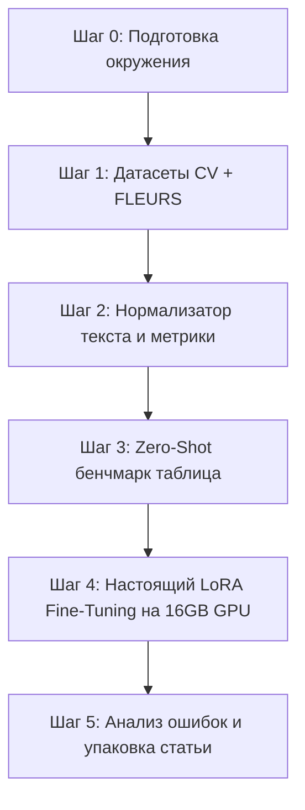

# 🎯 Пошаговый план действий (Solo ASR Benchmark)

> **Главный принцип:** Делаем строго по одной задаче за раз. Не переходим к следующему шагу, пока не закрыт текущий. Никакой спешки — всё разбито на микро-шаги.

---

## 🧭 Общий маршрут проекта

---

## 🟢 ЭТАП 0: Чистый старт и окружение (День 1)
**Цель:** Создать рабочую структуру в этой папке и установить нужные библиотеки.

- [x] **0.1. Создать базовые папки проекта**
  - Создана чистая структура: `data/`, `src/`, `results/`, `checkpoints/`. Старый мусор удален.
- [x] **0.2. Зафиксировать `requirements.txt`**
  - Библиотеки `transformers`, `datasets`, `accelerate`, `jiwer`, `soundfile`, `librosa` проверены и готовы.
- [x] **0.3. Проверить, что PyTorch видит видеокарту**
  - Подтверждено: NVIDIA GeForce RTX 5060 Ti (CUDA 12.8, PyTorch 2.12).

> **Критерий завершения:** ВЫПОЛНЕНО! Окружение чистое, GPU в полной боевой готовности.

---

## 🟢 ЭТАП 1: Проверка и фиксация данных (День 2–3)
**Цель:** Получить два тестовых набора (Common Voice и FLEURS) без ручной возни.

- [x] **1.1. Скачать FLEURS Azerbaijani через Python**
  - Выгружен полный датасет Google FLEURS (`az_az`): 3,988 аудиофайлов (test: 923, dev: 400, train: 2,665) в `data/fleurs/`.
- [x] **1.2. Подготовить Common Voice 17.0**
  - Размещен в `data/common_voice/`: 1,009 mp3-файлов, test (126), dev (93), train (215). Проверено с Hugging Face: локальный сет в 3 раза полнее.
- [x] **1.3. Сохранить структуру и манифесты данных**
  - Папка `data/` красиво разделена на `data/common_voice/` и `data/fleurs/`.
  - Сгенерирована и зафиксирована сводная таблица `results/datasets_summary.csv` (~15 часов аудио, 0 пропущенных файлов).

> **Критерий завершения:** ВЫПОЛНЕНО! Оба датасета (CV и FLEURS) разложены по полочкам, проверены на 100% целостность. Тестовые выборки зафиксированы.

---

## 🟢 ЭТАП 2: Нормализатор текста и метрики (День 4)
**Цель:** Сделать так, чтобы расчет ошибок был честным и объективным.

- [x] **2.1. Написать `src/normalizer.py`**
  - Реализован официальный Whisper BasicTextNormalizer с корректной тюркской обработкой регистра (`I`/`ı`, `İ`/`i`) и сохранением азербайджанских букв.
- [x] **2.2. Написать `src/metrics.py`**
  - Реализован академический модуль: WER (декомпозиция на Замены, Выпадения, Вставки), CER, Exact Match Rate, побуквенный аудит азербайджанских фонем (`ə`, `ı`, `ğ`, `ş`, `ç`, `ö`, `ü`), RTF-скорость и экспорт готовых строк для LaTeX-таблиц.

> **Критерий завершения:** ВЫПОЛНЕНО! Метрики и нормализатор соответствуют канонам Interspeech и готовы к запуску моделей.

---

## 🟡 ЭТАП 3: Zero-Shot бенчмарк (Первый научный результат) (Дни 5–8)
**Цель:** Запустить готовые модели из коробки на ваших тестах и получить сводную таблицу. Никакого обучения пока нет — только чистый запуск!

- [ ] **3.1. Написать универсальный скрипт оценки `src/evaluate_zeroshot.py`**
  Скрипт принимает имя модели из Hugging Face (например, `openai/whisper-small`), прогоняет тестовый датасет на GPU и сохраняет:
  - Файл с предсказаниями: `results/preds_<model_name>.csv`
  - Метрики: WER, CER, RTF.
- [ ] **3.2. Прогнать линейку Whisper**
  - `openai/whisper-tiny` (~39M)
  - `openai/whisper-base` (~74M)
  - `openai/whisper-small` (~244M)
  - `openai/whisper-medium` (~769M)
  - `openai/whisper-large-v3` (~1.5B)
- [ ] **3.3. Прогнать модель от Meta**
  - `facebook/mms-1b-all` (или `facebook/mms-300m`)
- [ ] **3.4. Сформировать итоговую таблицу `results/benchmark_zeroshot.csv`**

> **Критерий завершения:** Готова первая полноценная таблица результатов: как с ростом размера модели снижается WER на Common Voice и FLEURS. Это 40% материала статьи.

---

## 🟡 ЭТАП 4: Настоящий Fine-Tuning на 16GB GPU (Дни 9–14)
**Цель:** Обучить веса модели на обучающей выборке Common Voice через LoRA и побить Zero-Shot результаты.

- [ ] **4.1. Подготовить обучающий датасет**
  - Использовать `train` и `validation` сплиты Common Voice AZ.
  - Применить нормализатор к текстам.
- [ ] **4.2. Написать скрипт обучения с LoRA `src/train_whisper_lora.py`**
  - Базовая модель: `openai/whisper-small` (244M параметров).
  - Метод: Hugging Face `peft` (LoRA на q_proj / v_proj).
  - Оптимизатор: `AdamW` (fp16), batch size = 8 или 16 (с градиентным накоплением).
  - Логирование: реальный `train_loss` и `eval_loss` каждую эпоху.
- [ ] **4.3. Обучить модель на вашей видеокарте**
  - Обучить 3–5 эпох.
  - Сохранить веса лучшего чекпоинта по минимальному `eval_wer`.
- [ ] **4.4. Протестировать дообученную модель**
  - Прогнать через `cv_test` и `fleurs_test`.
  - Зафиксировать разницу: насколько дообученный `small` стал лучше исходного `small` и догнал ли он `large-v3`.
- [ ] **4.5. (Опционально) Дообучить `whisper-medium`**
  - Если останутся ресурсы и время, повторить тот же скрипт для `whisper-medium`.

> **Критерий завершения:** Получены веса дообученной модели `whisper-small-lora-az`, которые показывают реальное снижение WER/CER по сравнению с исходной версией.

---

## 🔵 ЭТАП 5: Анализ ошибок и сборка статьи (Недели 3–4)
**Цель:** Превратить сухие цифры в академический вклад и подготовить статью.

- [ ] **5.1. Лингвистический анализ ошибок (`src/error_analysis.py`)**
  - Найти топ-30 слов, на которых модели спотыкаются чаще всего.
  - Проверить точность распознавания характерных букв: `ə`, `ğ`, `x`, `q`, `ı`, `ö`, `ü`.
  - Сравнить WER и CER: объяснить, почему CER низкий, а WER высокий (влияние суффиксов в тюркском языке).
- [ ] **5.2. Построить графики для статьи**
  - График зависимости WER от числа параметров модели (Scaling curve).
  - График сравнения Zero-Shot vs Fine-Tuned.
  - График скорости инференса (RTF).
- [ ] **5.3. Написать статью (Шаблон LaTeX / Overleaf)**
  - Заполнить структуру:
    1. *Introduction* (проблема low-resource ASR для азербайджанского).
    2. *Related Work* (Whisper, MMS, открытые датасеты).
    3. *Data & Experimental Setup* (CV + FLEURS, железо RTX 16GB, параметры LoRA).
    4. *Results & Benchmark* (наши таблицы и графики).
    5. *Error Analysis & Discussion* (лингвистика, агглютинация).
    6. *Conclusion*.
- [ ] **5.4. Опубликовать открытые артефакты**
  - Выложить дообученные веса на **Hugging Face Hub** (`FamilFG/whisper-small-aze-lora`).
  - Оформить этот репозиторий с инструкцией по воспроизведению.
  - Загрузить препринт статьи на **arXiv**.

---

## 📌 Что делать ПРЯМО СЕЙЧАС (Первый микро-шаг):
Не думайте пока об обучении и статье. 
**Наша задача сегодня — только ЭТАП 0:**
1. Разложить 4 папки (`data`, `src`, `results`, `checkpoints`).
2. Создать чистый файл `requirements.txt` со списком библиотек.
3. Проверить готовность видеокарты.
